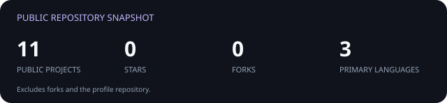

<h1 align="center">Premchand Das</h1>

<strong>Building products. Engineering systems. Learning by shipping.</strong>

Full-stack development · Startup technology · Cloud &amp; DevOps

  
  

## 01 / About me

I'm a developer and startup builder from India, working at the intersection of product development, backend engineering and practical DevOps. I enjoy turning ideas into working products and learning the infrastructure behind them.

**Currently building:** [Covisioner](https://covisioner.com), a startup discovery and hiring platform connecting startups with talent.

## 02 / Engineering toolkit

## 03 / Selected projects

| Project | Focus | Explore |
| --- | --- | --- |
| Covisioner | Startup discovery and hiring | [Visit product](https://covisioner.com) |
| SkepticCore | Critical thinking and knowledge platform | [Visit product](https://scipticcore.vercel.app) · [Source](https://github.com/premchand-das/ScipticCore) |
| SkepticCore Editor | Editor project | [Source](https://github.com/premchand-das/skepticcore-editor) |
| ReelFlow | Instagram Reel scheduling and publishing | [Visit product](https://reels.covisioner.com/) |
| Food Order | Food ordering project | [Source](https://github.com/premchand-das/food-order) |

## 04 / GitHub activity

<!-- Dynamic images appear after the Profile Assets workflow has run successfully. -->

  

  <picture>
    <source media="(prefers-color-scheme: dark)" srcset="https://raw.githubusercontent.com/premchand-das/developer-automation-hub/profile-artifacts/snake-dark.svg">
    
  </picture>

[Recently updated public repositories](https://github.com/premchand-das/developer-automation-hub/blob/profile-artifacts/projects.md) · [Full contribution history](https://github.com/premchand-das)

## 05 / Building in public

I use GitHub Actions to collect scheduled HTTP health snapshots of Covisioner. The monitoring commits are automated and separate from my manual development work.

[View monitoring reports](https://github.com/premchand-das/developer-automation-hub/tree/main/reports)

---

Always building. Always learning.

